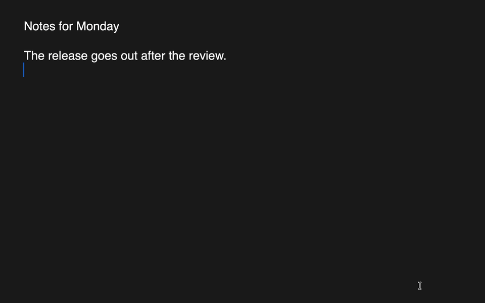
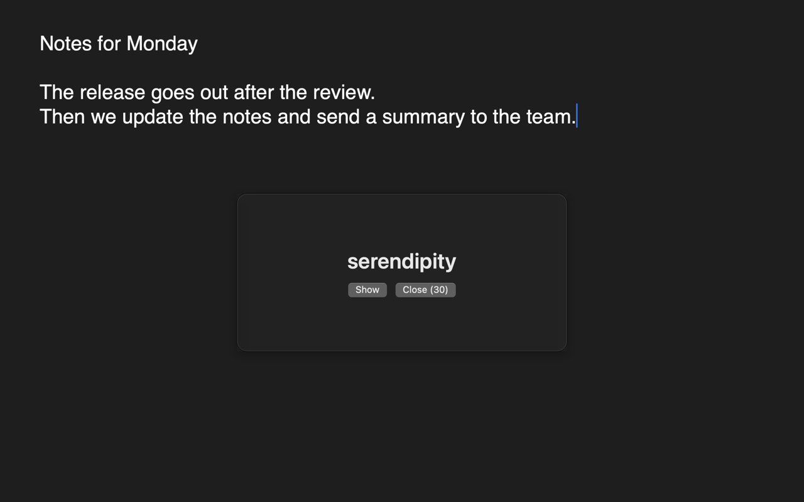
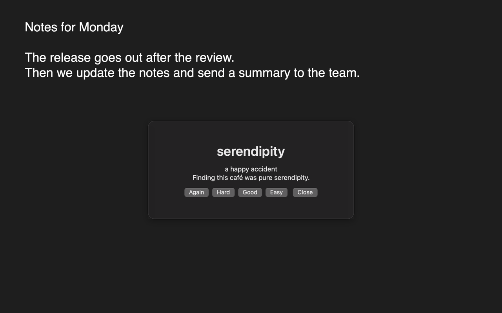
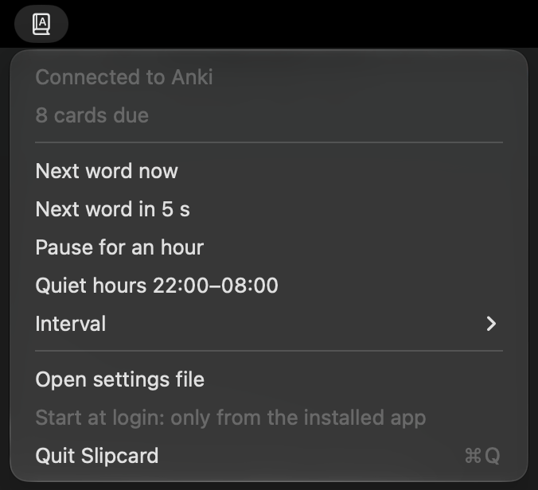

# Slipcard

Anki vocabulary cards in a timed popup from the tray: on top of full-screen
apps, never tiled, never stealing focus. macOS and Pop!_OS.



Every few minutes one card appears in the middle of the screen. You glance at
the word and keep typing, or reveal the answer and grade it. If you ignore it,
it closes itself after a countdown, and the card stays due. Anki keeps the
cards and the schedule; Slipcard only shows them.

**Status:** the MVP works on macOS 14+ and on Pop!_OS 24.04 (COSMIC) and is
in daily use. Nothing is released yet: you build it from source.

## Why

Spaced repetition works best with a few reviews spread through the day, but
the usual ways to get a card in front of you fail on a working desktop:

- system notifications on Pop!_OS disappear after about three seconds;
- an ordinary window is tiled on Pop!_OS (it splits the screen) and does not
  show over full-screen apps on macOS;
- a window that takes keyboard focus eats whatever you were typing.

## What it does

| The card | After Show | The menu bar menu |
|---|---|---|
|  |  |  |

The pictures are from macOS, with a demo deck.

- **The popup.** The front of the card and **Show**; after Show, the back and
  **Again / Hard / Good / Easy**, sent to Anki as your answer. **Close (30)**
  counts down and closes the popup without an answer. Moving the pointer over
  the popup stops the countdown. Popups never stack: the next interval starts
  when one closes.
- **No focus taken.** On macOS the popup is a non-activating panel on every
  Space, over full-screen apps. On Pop!_OS COSMIC it is a layer-shell overlay:
  not tiled, centred, never given the keyboard.
- **The tray / menu bar.** Whether Anki is reachable and how many cards are
  due; **Next word now** (or in 5 s); **Pause for an hour**; quiet hours
  (22:00–08:00 by default); the interval (5–60 min); the settings file;
  start at login.
- **Anki stays in charge.** Cards come from Anki through the
  [AnkiConnect](https://foosoft.net/projects/anki-connect/) add-on
  (`is:due -is:suspended` by default, any Anki search you like), and grades
  go back to it, so AnkiWeb sync, the mobile apps and the review schedule
  keep working.

## Quick start

You need Anki with the AnkiConnect add-on running (on the same computer by
default), and a build of Slipcard.

**macOS 14+** (Xcode 16 or its command line tools):

```sh
git clone https://github.com/petroladkin/slipcard.git
cd slipcard
scripts/macos-bundle.sh --install   # builds Slipcard.app into ~/Applications
open ~/Applications/Slipcard.app
```

**Pop!_OS 24.04, COSMIC:** install the build packages and gtk4-layer-shell
as [docs/development.md](docs/development.md#linux-popos-2404-cosmic) shows, then:

```sh
git clone https://github.com/petroladkin/slipcard.git
cd slipcard
scripts/linux-install.sh             # ~/.local/bin/slipcard and a launcher entry
slipcard                             # or start it from the launcher
```

With Ubuntu's versioned Rust packages (`rustc-1.91`, `cargo-1.91`), run the
install as `RUSTC=rustc-1.91 CARGO=cargo-1.91 scripts/linux-install.sh`.

The first popup comes one interval (15 minutes) after start; **Next word
now** in the tray shows one at once. Settings live in
`~/Library/Application Support/Slipcard/settings.json` on macOS and
`~/.config/slipcard/settings.json` on Linux; every key and its default is in
[docs/settings.example.json](docs/settings.example.json), and the tray's
**Open settings file** opens it.

## Anki on a server (optional)

Anki does not have to run on your computer. [`server/`](server/) is a Docker
Compose setup with a headless Anki that serves AnkiConnect to Slipcard and an
MCP server to AI assistants, with optional HTTPS. It has no authentication
and belongs on a network you trust. See [docs/server.md](docs/server.md).

[`claude-desktop/`](claude-desktop/) is a Claude Desktop extension that
connects Claude to that server's MCP.

## State and plans

| Platform | App | Popup |
|---|---|---|
| macOS 14+ | Swift, `macos/` | non-activating `NSPanel` on all Spaces, over full-screen apps |
| Pop!_OS 24.04 (COSMIC, Wayland) | GTK4 + Rust, `linux/` | layer-shell overlay surface |

On a desktop without layer-shell (GNOME, Pop!_OS 22.04) the Linux app still
runs, but the popup is an ordinary window that may be tiled or take focus.

Next: packages to download instead of building, a dictionary window, and
staying hidden during a call, screen sharing or a presentation.

Not planned: an own scheduling algorithm or sync, a card editor, Windows,
mobile apps (AnkiDroid and AnkiMobile already exist).

How the pieces fit: [docs/architecture.md](docs/architecture.md). Building,
testing and the workflow: [docs/development.md](docs/development.md).

## Contributing

Issues and pull requests are welcome; please read
[CONTRIBUTING.md](CONTRIBUTING.md) first. Security problems are reported
privately, see [SECURITY.md](SECURITY.md). Everyone taking part follows the
[Code of Conduct](CODE_OF_CONDUCT.md).

## License

[Apache License 2.0](LICENSE). Anki and AnkiConnect are separate projects with
their own licenses; Slipcard only talks to them over AnkiConnect's HTTP API
and does not include their code.
